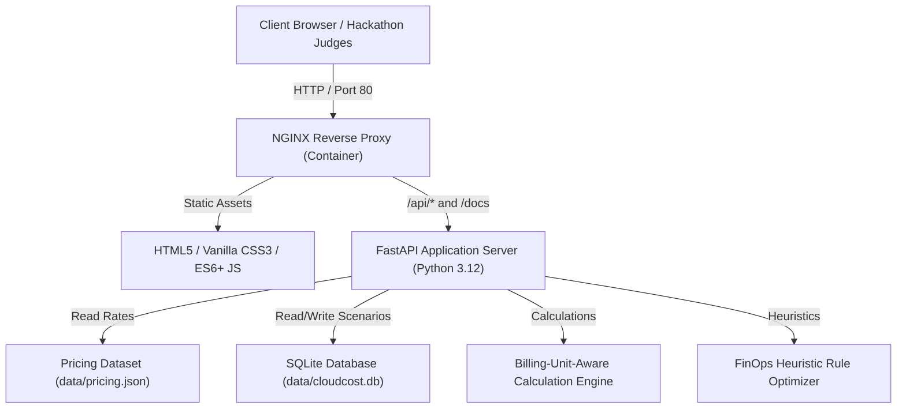

# CloudCost IQ — Cloud Resource Cost Estimator & Optimization Platform

[](https://github.com/cloudcost-iq/cloudcost-iq/actions/workflows/deploy.yml)
[](https://fastapi.tiangolo.com)
[](https://www.docker.com)
[](https://nginx.org)
[](https://python.org)
[](LICENSE)

> **DevOps Hackathon Project**: A production-grade FinOps engineering platform for modeling cloud infrastructure architectures, calculating billing-unit-aware expenditures, comparing baseline vs alternative configurations, and generating rule-based cost optimization recommendations.

---

## 📑 Table of Contents

1. [Executive Summary & Problem Statement](#1-executive-summary--problem-statement)
2. [Key Capabilities & Features](#2-key-capabilities--features)
3. [System Architecture](#3-system-architecture)
4. [Technology Stack](#4-technology-stack)
5. [Repository Structure](#5-repository-structure)
6. [Pricing Model & Dataset](#6-pricing-model--dataset)
7. [Calculation Formulas & Methodology](#7-calculation-formulas--methodology)
8. [Judge's Demonstration Walkthrough (Expected Results)](#8-judges-demonstration-walkthrough-expected-results)
9. [Local Development Setup](#9-local-development-setup)
10. [Automated Testing](#10-automated-testing)
11. [Docker & Containerized Deployment](#11-docker--containerized-deployment)
12. [AWS EC2 Ubuntu Cloud VM Deployment Guide](#12-aws-ec2-ubuntu-cloud-vm-deployment-guide)
13. [HTTPS & TLS Configuration (Let's Encrypt)](#13-https--tls-configuration-lets-encrypt)
14. [GitHub Actions CI/CD Pipeline](#14-github-actions-cicd-pipeline)
15. [Rollback & Disaster Recovery](#15-rollback--disaster-recovery)
16. [Security Best Practices](#16-security-best-practices)
17. [Assumptions & Limitations](#17-assumptions--limitations)

---

## 1. Executive Summary & Problem Statement

Modern cloud-native applications often experience unpredictable operational expenditure (**OpEx**) due to over-provisioned virtual machines, continuous 24/7 runtime on non-production environments, inefficient block storage allocations, and unoptimized relational database redundancy. Engineering teams require transparent capacity modeling before committing to cloud provider architectures.

**CloudCost IQ** solves this problem by providing:
- **Real-Time Cost Modeling**: Fine-grained capacity planning across 10 distinct cloud resource categories.
- **Side-by-Side Dual Architecture Comparison**: Direct financial contrast between baseline (Config A) and optimized (Config B) topologies.
- **Automated FinOps Optimization**: Heuristic rule engine that uncovers high-impact savings (e.g., scheduled dev environments, Graviton right-sizing, storage tiering).
- **Persistent Infrastructure Scenarios**: Embedded SQLite storage for versioning and replaying architectures.
- **Enterprise Reports**: Instant CSV manifests, JSON definitions, and printable executive summaries.

---

## 2. Key Capabilities & Features

### 🎛️ 1. Interactive Resource Cost Estimator
- Supports 10 cloud categories: Virtual Machines, Custom CPU/RAM, Block Storage, Object Storage, Managed Databases, Data Transfer & Bandwidth, Load Balancers, Managed Containers/K8s, Serverless Functions, and Monitoring/Observability.
- Dynamic operational scheduling (Always-On 730h, Business Hours 174h, Dev Hours 160h, or Custom 1-744h).
- Fine-grained controls to add, duplicate, adjust quantity, and delete resources.

### ⚖️ 2. Dual Configuration Comparison
- Independent Configuration A (Baseline) and Configuration B (Optimized) modeling.
- Side-by-side cost difference ($ and % savings).
- Top savings drivers analysis and automated technical trade-off advisories.
- Category-level comparative bar chart.

### 💡 3. Rule-Based FinOps Optimization Engine
- **Scheduled Compute Rule (`OPT-SCHEDULED-COMPUTE`)**: Calculates ~76% savings by migrating always-on dev/staging compute to 8x5 schedules (174 hrs/mo).
- **Right-Sizing Rule (`OPT-RIGHTSIZE-COMPUTE`)**: Detects overprovisioned x86 monoliths and models ARM Graviton alternatives.
- **Storage Tiering Rule (`OPT-TIERED-STORAGE`)**: Flags large EBS block disks (>250 GB) and suggests offloading static files to S3 object storage.
- **Database Multi-AZ Check (`OPT-DB-MULTIAZ`)**: Alerts on costly Multi-AZ instances in dev/staging environments.
- **Idle / Zero-Quantity Detection (`OPT-ZERO-QTY`)**: Identifies unallocated resource configurations.

### 💾 4. Persistence & Deliverables
- SQLite scenario storage pre-seeded with real-world DevOps templates.
- One-click export to formatted JSON and CSV line-item manifests.
- Browser print-ready executive summary report.
- Interactive FastAPI OpenAPI Swagger UI at `/docs`.

---

## 3. System Architecture



### Physical Container Topology:
```
[ Internet / Public Cloud VM Security Group ]
            │
            ▼ (Port 80 HTTP / Port 443 HTTPS)
┌────────────────────────────────────────────────────────┐
│ NGINX Container (`cloudcost-web`)                      │
│ - Security Headers (X-Frame-Options, X-Content-Type)   │
│ - Gzip Compression & Asset Caching (7d)                │
│ - Upstream Proxying to http://backend:8000             │
└───────────────────────────┬────────────────────────────┘
                            │ (Docker Internal Bridge Network)
                            ▼
┌────────────────────────────────────────────────────────┐
│ FastAPI ASGI Container (`cloudcost-backend`)           │
│ - Non-Root Execution (`appuser:appgroup` UID 1001)    │
│ - Pydantic Validation & Swagger OpenAPI Documentation  │
│ - Calculation Engine & FinOps Optimizer                │
└───────────────────────────┬────────────────────────────┘
                            │ (Persistent Docker Volume: `cloudcost_data`)
                            ▼
┌────────────────────────────────────────────────────────┐
│ Persistent Storage Layer                               │
│ - `data/cloudcost.db` (SQLite 3 Scenario Persistence)  │
│ - `data/pricing.json` (Illustrative Benchmark Rates)   │
└────────────────────────────────────────────────────────┘
```

---

## 4. Technology Stack

| Layer | Technology | Rationale |
|---|---|---|
| **Frontend** | HTML5, Vanilla CSS3, JavaScript ES6+ | Zero external framework overhead, lightning fast load time, full responsive control. |
| **Styling & Aesthetics** | Dark Navy Glassmorphism CSS System | Electric cyan/blue accents, responsive CSS grid, light/dark mode persistence. |
| **Charts** | Chart.js 4.4 | Hardware-accelerated canvas charts for cost distribution and projections. |
| **Backend API** | Python 3.12, FastAPI, Uvicorn | High-performance asynchronous API with automatic OpenAPI documentation. |
| **Data Validation** | Pydantic v2 | Strict request/response typing and input sanitization. |
| **Persistence** | SQLite 3 | Embedded, zero-configuration ACID storage for scenario management. |
| **Web Server** | NGINX 1.25 Alpine | Reverse proxy, TLS termination, gzip compression, and security headers. |
| **Containerization** | Docker, Docker Compose | Reproducible multi-stage container build and isolated network orchestration. |
| **Automated Testing** | Pytest, FastAPI TestClient | 29 automated test cases for calculations, schema validation, and API routes. |
| **CI/CD** | GitHub Actions | Automated linting, test execution, container image builds, and SSH cloud VM deployment. |

---

## 5. Repository Structure

```
cloudcost-iq/
├── .github/
│   └── workflows/
│       └── deploy.yml          # GitHub Actions CI/CD pipeline
├── backend/
│   ├── app/
│   │   ├── __init__.py
│   │   ├── main.py             # FastAPI entrypoint, CORS, static routes
│   │   ├── database.py         # SQLite persistence & scenario seeding
│   │   ├── routes/
│   │   │   ├── __init__.py
│   │   │   ├── health.py       # Healthcheck & system telemetry
│   │   │   ├── pricing.py      # Pricing catalog endpoints
│   │   │   ├── estimate.py     # Cost estimation endpoint
│   │   │   ├── compare.py      # Dual architecture comparison
│   │   │   ├── optimize.py     # FinOps optimization rules
│   │   │   └── scenarios.py    # Scenario CRUD persistence
│   │   ├── services/
│   │   │   ├── __init__.py
│   │   │   ├── calculator.py   # Billing-unit-aware calculation engine
│   │   │   ├── optimizer.py    # Rule-based FinOps heuristics
│   │   │   └── pricing_loader.py # Pricing dataset caching
│   │   └── schemas/
│   │       ├── __init__.py
│   │       ├── estimate.py     # Pydantic estimate schemas
│   │       ├── compare.py      # Pydantic comparison schemas
│   │       ├── pricing.py      # Pricing dataset schemas
│   │       ├── scenario.py     # Scenario schemas
│   │       └── optimization.py # Optimization response schemas
│   ├── tests/
│   │   ├── __init__.py
│   │   ├── test_calculator.py  # Unit tests for cost calculations
│   │   ├── test_optimizer.py   # Unit tests for optimization rules
│   │   ├── test_pricing.py     # Schema validation for pricing.json
│   │   └── test_api.py         # FastAPI TestClient endpoint integration tests
│   └── requirements.txt        # Python backend dependencies
├── data/
│   └── pricing.json            # Documented 10-category illustrative dataset
├── deploy/
│   ├── nginx.conf              # Production Nginx reverse-proxy config
│   ├── deploy.sh               # Automated deployment script for cloud VM
│   └── rollback.sh             # Automated disaster recovery rollback script
├── frontend/
│   ├── assets/
│   │   └── logo.svg            # Custom vector brand asset
│   ├── css/
│   │   └── style.css           # Modern dark navy & light FinOps design system
│   ├── js/
│   │   ├── api.js              # REST client with offline fallback
│   │   ├── calculator.js       # Client calculation & optimization logic
│   │   ├── charts.js           # Chart.js visualization handlers
│   │   ├── scenarios.js        # Infrastructure presets
│   │   ├── export.js           # JSON, CSV, and print report export
│   │   └── app.js              # Main coordinator and view router
│   └── index.html              # Responsive 8-view dashboard UI
├── Dockerfile                  # Multi-stage non-root container definition
├── docker-compose.yml          # Nginx + FastAPI orchestration
├── .dockerignore
├── .gitignore
├── .env.example                # Configuration placeholders
└── README.md                   # Comprehensive technical documentation
```

---

## 6. Pricing Model & Dataset

Pricing rates are located in `data/pricing.json`.

> ⚠️ **Important Disclaimer**: All pricing rates in this dataset are illustrative benchmark figures designed for architecture cost modeling, capacity planning, and DevOps hackathon evaluation. They reflect typical US-East baseline public cloud pricing without reserved discounts, enterprise agreements, regional premiums, or dynamic egress surcharges. The platform operates independently without requiring paid third-party billing APIs or cloud accounts.

Every dataset entry provides:
- `id`: Unique identifier (e.g. `vm-aws-t4g-medium`, `storage-ebs-gp3`)
- `name`: Human-readable label
- `category`: Compute, block storage, object storage, databases, networking, load balancers, containers, serverless, or monitoring
- `provider`: Provider attribution label (e.g. `AWS (Illustrative)`, `GCP (Illustrative)`)
- `billing_unit`: Unit duration or capacity (`per_hour`, `per_gb_month`, `per_request_million`, `per_cluster_hour`, etc.)
- `unit_price`: Base rate in USD
- `currency`: "USD"
- `specs`: Hardware characteristics (vCPU, RAM, IOPS, Network bandwidth)
- `last_updated`: Maintenance date

---

## 7. Calculation Formulas & Methodology

### 1. Hourly Resources (`per_hour`, `per_cluster_hour`)
$$\text{Hourly Cost} = \text{Unit Price} \times \text{Quantity}$$
$$\text{Monthly Cost} = \text{Hourly Cost} \times \text{Scheduled Usage Hours per Month}$$
*(Full 24/7 runtime defaults to 730 reference hours; business schedule defaults to 174 hours).*

### 2. Capacity & Request-Based Resources (`per_gb_month`, `per_request_million`, `per_gb_ingested`)
$$\text{Monthly Cost} = \text{Unit Price} \times \text{Allocated Quantity}$$
$$\text{Hourly Cost Equivalent} = \frac{\text{Monthly Cost}}{\text{Reference Hours (730)}}$$

### 3. Aggregate Figures
$$\text{Total Monthly Cost} = \sum \text{Monthly Resource Costs}$$
$$\text{Estimated Annual Cost} = \text{Total Monthly Cost} \times 12$$

### 4. Variance & Savings
$$\text{Monthly Savings} = \text{Baseline Cost (Config A)} - \text{Alternative Cost (Config B)}$$
$$\text{Percentage Savings} = \left( \frac{\text{Monthly Savings}}{\text{Baseline Cost}} \right) \times 100 \quad (\text{if Baseline Cost} > 0)$$

---

## 8. Judge's Demonstration Walkthrough (Expected Results)

When demonstrating CloudCost IQ to judges, use this verified end-to-end benchmark comparison:

### Scenario: Monolithic Heavy Architecture (Config A) vs Modern FinOps Stack (Config B)

#### Configuration A (Heavy Legacy Baseline):
1. **Compute**: 2x `AWS r6i.2xlarge` (8 vCPU, 64 GB RAM) running 730h @ $0.5040/hr = **$735.84/mo**
2. **Storage**: 500 GB `AWS EBS io2 Provisioned SSD` @ $0.1250/GB = **$62.50/mo**
3. **Database**: 1x `AWS RDS db.m6i.large (Multi-AZ)` running 730h @ $0.3840/hr = **$280.32/mo**
4. **Load Balancers**: 2x `AWS Application Load Balancer` running 730h @ $0.0225/hr = **$32.85/mo**
5. **Observability**: 200 GB `CloudWatch Logs Ingestion` @ $0.5000/GB = **$100.00/mo**
- **Total Config A Monthly Cost: $1,211.51/month** ($14,538.12/year)

#### Configuration B (Optimized Modern Cloud Stack):
1. **Compute**: 2x `AWS t4g.medium (ARM Graviton2)` (2 vCPU, 4 GB RAM) running 730h @ $0.0336/hr = **$49.06/mo**
2. **Storage**: 100 GB `AWS EBS gp3 SSD` @ $0.0800/GB = **$8.00/mo**
3. **Database**: 1x `AWS RDS db.t4g.medium` running 730h @ $0.0730/hr = **$53.29/mo**
4. **Load Balancer**: 1x `AWS Application Load Balancer` running 730h @ $0.0225/hr = **$16.43/mo**
5. **Object Storage**: 250 GB `AWS S3 Standard` (offloaded assets) @ $0.0230/GB = **$5.75/mo**
6. **Egress**: 300 GB `Internet Bandwidth` @ $0.0900/GB = **$27.00/mo**
7. **Observability**: 2x `Custom CloudWatch Metrics` @ $0.0041/hr = **$5.99/mo**
- **Total Config B Monthly Cost: $165.52/month** ($1,986.24/year)

#### Verified Financial Variance:
- **Net Monthly Savings**: **$1,045.99 / month**
- **Annualized Savings**: **$12,551.88 / year**
- **Percentage Cost Reduction**: **86.3% reduction**
- **Top Savings Driver**: Replacing over-provisioned `r6i.2xlarge` with right-sized `t4g.medium` (saves $686.78/mo).

---

## 9. Local Development Setup

### Prerequisites
- Python 3.12+ (or 3.10+)
- Git

### 1. Clone & Enter Repository
```bash
git clone https://github.com/cloudcost-iq/cloudcost-iq.git
cd cloudcost-iq
```

### 2. Create Virtual Environment
```bash
# On Linux/macOS
python3 -m venv venv
source venv/bin/activate

# On Windows PowerShell
python -m venv venv
.\venv\Scripts\Activate.ps1
```

### 3. Install Dependencies
```bash
pip install -r backend/requirements.txt
```

### 4. Run Development Server
```bash
uvicorn backend.app.main:app --reload --host 127.0.0.1 --port 8000
```
- Web Application: [http://localhost:8000/](http://localhost:8000/)
- Interactive API Docs (Swagger): [http://localhost:8000/docs](http://localhost:8000/docs)
- API Health Status: [http://localhost:8000/api/health](http://localhost:8000/api/health)

---

## 10. Automated Testing

CloudCost IQ includes 29 automated tests validating calculation formulas, edge cases (zero quantities, zero baselines, negative input rejection), rule-based optimization heuristics, pricing JSON schema integrity, and FastAPI routes.

### Run the Pytest Suite:
```bash
python -m pytest backend/tests -v
```

### Test Suite Summary:
```text
backend/tests/test_api.py::test_api_health PASSED
backend/tests/test_api.py::test_api_system_info PASSED
backend/tests/test_api.py::test_api_pricing PASSED
backend/tests/test_api.py::test_api_pricing_single_and_404 PASSED
backend/tests/test_api.py::test_api_estimate_endpoint PASSED
backend/tests/test_api.py::test_api_compare_endpoint PASSED
backend/tests/test_api.py::test_api_optimize_endpoint PASSED
backend/tests/test_api.py::test_api_scenarios_crud PASSED
backend/tests/test_api.py::test_api_validation_error PASSED
backend/tests/test_calculator.py::test_hourly_resource_calculation PASSED
backend/tests/test_calculator.py::test_multiple_quantity_hourly PASSED
backend/tests/test_calculator.py::test_custom_usage_schedule PASSED
backend/tests/test_calculator.py::test_non_hourly_storage_calculation PASSED
backend/tests/test_calculator.py::test_request_based_serverless_calculation PASSED
backend/tests/test_calculator.py::test_zero_quantity_handling PASSED
backend/tests/test_calculator.py::test_negative_quantity_raises_value_error PASSED
backend/tests/test_calculator.py::test_invalid_hours_raises_value_error PASSED
backend/tests/test_calculator.py::test_missing_resource_raises_value_error PASSED
backend/tests/test_calculator.py::test_full_infrastructure_estimate PASSED
backend/tests/test_calculator.py::test_compare_configurations_savings PASSED
backend/tests/test_calculator.py::test_compare_zero_baseline PASSED
backend/tests/test_optimizer.py::test_scheduled_compute_rule PASSED
backend/tests/test_optimizer.py::test_rightsize_compute_rule PASSED
backend/tests/test_optimizer.py::test_storage_tiering_rule PASSED
backend/tests/test_optimizer.py::test_multiaz_db_rule PASSED
backend/tests/test_optimizer.py::test_zero_quantity_rule PASSED
backend/tests/test_pricing.py::test_pricing_dataset_loads_and_has_keys PASSED
backend/tests/test_pricing.py::test_pricing_entries_schema_integrity PASSED
backend/tests/test_pricing.py::test_filter_by_category PASSED

======================== 29 passed in 2.23s ========================
```

---

## 11. Docker & Containerized Deployment

CloudCost IQ uses a multi-container Docker Compose architecture:
1. `backend`: Multi-stage Python 3.12 slim image running as non-root user `appuser`.
2. `web`: NGINX Alpine reverse proxy serving static assets and proxying `/api` requests.
3. `cloudcost_data`: Named volume providing persistent SQLite scenario storage.

### 1. Launch with Docker Compose:
```bash
docker compose up -d --build
```

### 2. Verify Container Health:
```bash
docker compose ps
curl -f http://localhost/api/health
```

### 3. Check Live Logs:
```bash
docker compose logs -f backend
docker compose logs -f web
```

### 4. Stop Containers:
```bash
docker compose down
```

---

## 12. AWS EC2 Ubuntu Cloud VM Deployment Guide

Follow these step-by-step instructions to deploy CloudCost IQ on a real AWS EC2 virtual machine accessible via a public IP or custom domain.

### Step 1: AWS Account & Budget Protection
1. Log in to the [AWS Management Console](https://aws.amazon.com/console/).
2. Enable Multi-Factor Authentication (MFA) on your root or IAM administrative account.
3. Navigate to **AWS Budgets** and create a **Zero Spend Budget** or **Monthly Cost Alert** (e.g. $5.00 limit) to prevent unexpected charges.

### Step 2: Launch EC2 Virtual Machine
1. Open the **EC2 Dashboard** and click **Launch Instance**.
2. **Name**: `cloudcost-iq-production`
3. **Application & OS Image**: `Ubuntu Server 24.04 LTS (HVM), SSD Volume Type` (64-bit ARM or x86).
4. **Instance Type**:
   - Recommended: `t4g.small` (2 vCPU, 2 GB RAM - ARM Graviton) or `t3.micro` / `t3.small` (x86_64).
5. **Key Pair**: Create or select an existing SSH key pair (`cloudcost-key.pem`).
6. **Storage**: 20 GB `gp3` SSD root volume.

### Step 3: Configure Inbound Security Group Firewall
Configure the EC2 Security Group inbound rules:
| Type | Port | Protocol | Source | Purpose |
|---|---|---|---|---|
| **SSH** | 22 | TCP | `My IP` (or restricted subnet) | Secure administrative terminal access |
| **HTTP** | 80 | TCP | `0.0.0.0/0` (Anywhere) | Public web traffic and Let's Encrypt validation |
| **HTTPS** | 443 | TCP | `0.0.0.0/0` (Anywhere) | Encrypted TLS web traffic |

*Do NOT expose backend port 8000 publicly. NGINX handles all ingress routing.*

### Step 4: Connect to Your VM & Install Docker
```bash
# Set key permissions
chmod 400 cloudcost-key.pem

# Connect via SSH
ssh -i "cloudcost-key.pem" ubuntu@<YOUR-EC2-PUBLIC-IP>

# Update packages and install Docker + Docker Compose
sudo apt-get update && sudo apt-get upgrade -y
sudo apt-get install -y docker.io docker-compose-v2 git curl
sudo systemctl enable --now docker
sudo usermod -aG docker $USER

# Log out and log back in for group membership to take effect
exit
ssh -i "cloudcost-key.pem" ubuntu@<YOUR-EC2-PUBLIC-IP>
```

### Step 5: Deploy CloudCost IQ
```bash
# Clone the repository
git clone https://github.com/cloudcost-iq/cloudcost-iq.git /opt/cloudcost-iq
cd /opt/cloudcost-iq

# Run the automated deployment script
bash deploy/deploy.sh
```

### Step 6: Verify Deployment
Open your browser and navigate to:
```
http://<YOUR-EC2-PUBLIC-IP>/
```
Test the health endpoint:
```bash
curl http://<YOUR-EC2-PUBLIC-IP>/api/health
```

---

## 13. HTTPS & TLS Configuration (Let's Encrypt)

To secure the application with a trusted SSL/TLS certificate:

1. **Point your DNS**: Create an `A` record in your DNS provider (e.g. Route 53, Cloudflare) pointing `cloudcost.yourdomain.com` to your EC2 Public IP.
2. **Install Certbot on the Host or Container**:
   ```bash
   sudo apt-get install -y certbot python3-certbot-nginx
   sudo certbot --nginx -d cloudcost.yourdomain.com
   ```
3. Test certificate auto-renewal:
   ```bash
   sudo certbot renew --dry-run
   ```

---

## 14. GitHub Actions CI/CD Pipeline

The included GitHub Actions workflow (`.github/workflows/deploy.yml`) automates testing and deployment:

### Required GitHub Repository Secrets
Navigate to **Settings > Secrets and variables > Actions** in your GitHub repository and add:
- `DEPLOY_HOST`: The public IPv4 address or domain of your EC2 VM (e.g. `54.210.12.34` or `cloudcost.example.com`).
- `DEPLOY_USER`: The SSH username (typically `ubuntu`).
- `DEPLOY_SSH_KEY`: The private OpenSSH key contents matching the public key on the VM.

### How the Pipeline Works:
1. **Pull Request or Push to `main`**:
   - Spawns an Ubuntu runner with Python 3.12.
   - Installs backend requirements and validates dataset schema.
   - Runs all 29 `pytest` unit and integration tests.
   - Verifies Docker container image builds.
2. **Main Branch Automated Deployment**:
   - Authenticates to the target VM over SSH using secrets.
   - Updates application code and executes `deploy/deploy.sh`.
   - Polls `/api/health` until verified healthy.

---

## 15. Rollback & Disaster Recovery

If an update fails health checks:
1. The `deploy.sh` script automatically triggers `deploy/rollback.sh`.
2. The rollback script stops degraded containers, restores the previous `data/cloudcost.db.bak` database backup, and re-launches the last stable release.
3. To manually trigger a rollback:
   ```bash
   cd /opt/cloudcost-iq
   bash deploy/rollback.sh
   ```

---

## 16. Security Best Practices

- **Non-Root User**: The backend Docker container executes under a dedicated `appuser` (UID 1001) without root privileges.
- **Reverse Proxy Protection**: Only NGINX (ports 80/443) is exposed to the public internet. Port 8000 is internal to the Docker bridge network.
- **Security Headers**: Standard OWASP headers (`X-Frame-Options: SAMEORIGIN`, `X-Content-Type-Options: nosniff`, `X-XSS-Protection`) are enforced on every response.
- **Zero Hardcoded Secrets**: Secrets are injected via environment variables or GitHub Actions Secrets.
- **Input Sanitization**: Pydantic models validate all API payloads; SQLite queries use parameterized placeholders (`?`) to prevent SQL injection.

---

## 17. Assumptions & Limitations

- **Dataset**: Pricing figures are representative benchmark estimates designed for architectural comparison and DevOps evaluation.
- **Regional Variations**: Default figures assume baseline US-East/Multi-Region pricing.
- **Billing Horizon**: Standard monthly calculations assume 730 reference hours per month.
- **Telemetry**: Cost optimization recommendations are derived from user-configured resources and operational schedules, not real-time cloud agent metrics.

---

## 👨‍💻 Hackathon Project Information

- **Project Name**: CloudCost IQ — Cloud Resource Cost Estimator & Optimization Platform
- **Release Version**: 1.0.0
- **Evaluation Category**: DevOps, Cloud Architecture & FinOps Automation
- **License**: MIT Open Source License
